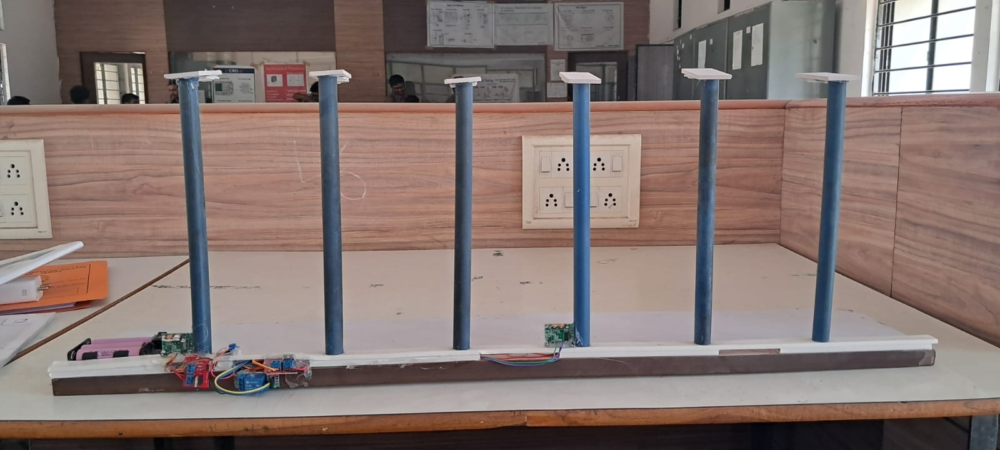
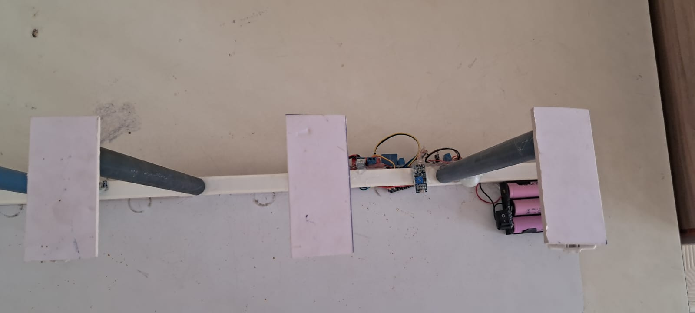

# Arduino-Based Smart Street Light System

An automated, energy-saving street lighting project powered by an **Arduino Nano**, an **LDR (Light Dependent Resistor)**, and a **PIR Motion Sensor** to optimize power usage based on daylight and movement.

## Key Features

- **Day/Night Detection:** LDR keeps lights off during the day and active at night.
- **Motion Activation:** PIR sensor boosts lights to full brightness when movement is detected.
- **Adaptive Dimming:** Reduces brightness during idle periods to save energy.

## Hardware Components

- Arduino Nano
- LDR (Light Dependent Resistor) & 10kΩ Resistor
- HC-SR501 PIR Motion Sensor
- High-Power LED Module / Relay Driver
- Arduino IDE (C/C++)

## How It Works

1. **Daytime:** LDR senses light and keeps LEDs **OFF**.
2. **Nighttime:** System enters low-power standby or dimmed mode.
3. **Motion Detected:** PIR triggers full brightness until the area clears.

## Repository Structure

- [Smart_Street_Light.ino](./Smart_Street_Light.ino) – Control sketch for LDR, PIR, and PWM dimming
- [prototype_photo1.jpg](./prototype_photo1.jpg) – Hardware wiring and sensor connections
- [prototype_photo2.jpg](./prototype_photo2.jpg) – Complete hardware prototype setup

### Hardware Prototype

#### 1. Hardware Wiring & Sensor Connections

#### 2. Complete Hardware Prototype Setup

## Author

**Trusha Tanna**  
B.E. in Electronics and Communication Engineering | Government Engineering College, Bhavnagar  
- **Portfolio:** [View Live Portfolio](https://github.io)
- **Email:** trushatanna0208@gmail.com
